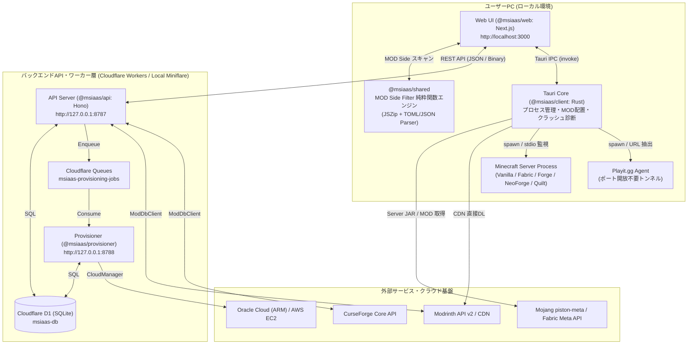
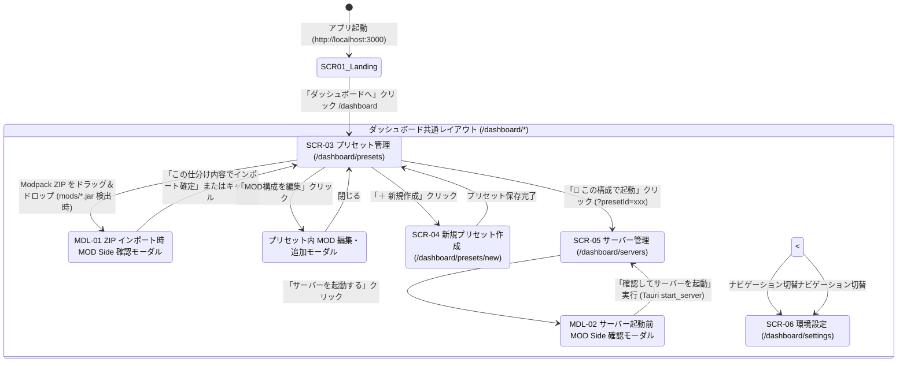
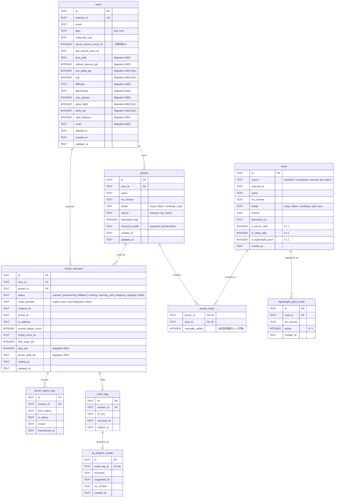

# 外部設計書（External Design）

## 1. システム概要・アーキテクチャ

**Minecraft MSIaaS (Minecraft Server Infrastructure as a Service)** は、「遊びたい MOD や Modpack ZIP を選ぶだけ」で、MOD の依存関係解決・クライアント専用 MOD の自動除外（MOD Side Filter）・サーバー構築・P2P トンネル共有（Playit.gg）・クラッシュ原因の日本語自動診断までを一貫して自動化するデスクトップ＆クラウド連携プラットフォームです。

### 1.1 システム全体構成図

---

## 2. 画面一覧と画面遷移設計

### 2.1 画面・モーダル一覧

| 画面ID | パス / 種別 | 画面名 | 主な役割・機能 | 対応ソースファイル |
| :--- | :--- | :--- | :--- | :--- |
| `SCR-01` | `/` | トップ（ランディング）画面 | サービス概要表示、ダッシュボードへのエントリー | [page.tsx](file:///c:/Users/yasud/minecraft-msiaas/apps/web/src/app/page.tsx) |
| `SCR-02` | `/dashboard` | ダッシュボード（リダイレクト） | `/dashboard/presets` への自動ルーティング | [page.tsx](file:///c:/Users/yasud/minecraft-msiaas/apps/web/src/app/dashboard/page.tsx) |
| `SCR-03` | `/dashboard/presets` | プリセット管理（マイライブラリ） | プリセット一覧、MODパック ZIP ドラッグ＆ドロップ取込、個別 MOD 追加・削除 | [presets/page.tsx](file:///c:/Users/yasud/minecraft-msiaas/apps/web/src/app/dashboard/presets/page.tsx) |
| `MDL-01` | モーダル (`SCR-03`内) | MOD Side 自動判定・仕分け確認モーダル | ZIP 内の `.jar` を `server` / `client_only` / `unknown` に分類し、インポート前に確認・トグル選択 | [presets/page.tsx](file:///c:/Users/yasud/minecraft-msiaas/apps/web/src/app/dashboard/presets/page.tsx#L1107-L1255) |
| `SCR-04` | `/dashboard/presets/new` | 新規プリセット作成（ウィザード） | バージョン・ローダー選択（Fabric / Forge / NeoForge / Quilt）、MOD 検索・カート追加、プリセット保存 | [presets/new/page.tsx](file:///c:/Users/yasud/minecraft-msiaas/apps/web/src/app/dashboard/presets/new/page.tsx) |
| `SCR-05` | `/dashboard/servers` | サーバー管理・稼働モニター | サーバー起動・停止、接続アドレス（Playit.gg / ローカルIP）表示、ゲスト配布用MOD一括ZIP出力、詳細クラッシュ診断ログ表示 | [servers/page.tsx](file:///c:/Users/yasud/minecraft-msiaas/apps/web/src/app/dashboard/servers/page.tsx) |
| `MDL-02` | モーダル (`SCR-05`内) | サーバー起動前 MOD Side 最終確認モーダル | サーバー起動直前に導入 MOD の Side を最終確認し、`client_only` の自動除外と `unknown` の採用可否を決定 | [servers/page.tsx](file:///c:/Users/yasud/minecraft-msiaas/apps/web/src/app/dashboard/servers/page.tsx#L665-L796) |
| `SCR-06` | `/dashboard/settings` | 環境設定・サーバープロパティ設定 | Java パス指定、メモリ割当量（GB）、Playit.gg ON/OFF、`server.properties`（ゲームモード、難易度、PvP、描画距離、MOTD 等）の永続化 | [settings/page.tsx](file:///c:/Users/yasud/minecraft-msiaas/apps/web/src/app/dashboard/settings/page.tsx) |

### 2.2 画面遷移図

---

## 3. UI 外部仕様（MOD Side Filter & クラッシュ診断）

### 3.1 MOD Side 確認画面（`MDL-01` / `MDL-02`）の3区分表示仕様

サーバー起動前および ZIP インポート時に、以下の3カテゴリに分けてユーザーへ提示します。

1. **✅ サーバーに追加されるMOD (`server`)**
   - サーバー互換（`server` または `both`）と判定された MOD の一覧を表示し、サーバーの `mods/` ディレクトリへ配置対象とします。
2. **🚫 クライアント専用として除外されるMOD (`client_only`)**
   - クライアント専用（`fabric.mod.json` / `quilt.mod.json` の `environment: "client"`、または `META-INF/mods.toml` の `side="CLIENT"` 等）と判定された MOD の名前と**除外理由（`reason`）**を表示し、サーバーから自動スキップします。
3. **❓ 判定不明のMOD (`unknown`)**
   - メタデータが存在しない、または Side 記述がない MOD の一覧を表示します。
   - **デフォルトは「除外 (`client`)」** に設定され、ユーザーが `Client (除外)` / `Server` / `Both` の3択トグルボタンで明示的に `Server` または `Both` を選択した MOD のみがサーバーへ追加されます。

### 3.2 サーバー起動失敗時の詳細クラッシュ診断ログ表示

サーバー起動テスト時に Java プロセスが異常終了した場合、標準出力・標準エラー出力の履歴（直近500行）および最新の `crash-reports/crash-*.txt` を解析し、`SCR-05`（サーバー管理画面）のエラーバナーに以下の診断結果を日本語で整形表示します。

- **不足している前提MOD（Missing Dependencies）**: どの MOD がどの前提 MOD（および必要バージョン）を要求しているか
- **バージョン不一致（Version Mismatch）**: Minecraft 本体バージョンやローダー（Fabric Loader / Forge / NeoForge）の不一致箇所
- **クライアント専用MODの混入（Client-side Mod on Dedicated Server）**: `net.minecraft.client.*` や `ENV CLIENT` 等のクラスロード失敗を引き起こした原因 MOD
- **Java バージョン不一致（UnsupportedClassVersionError）**: `class file version 65.0`（Java 21 必須）など必要な Java ランタイムの案内

---

## 4. REST API 外部インターフェース仕様

ベース URL（開発環境）: `http://127.0.0.1:8787`
認証ヘッダー: 本番環境は `Cf-Access-Jwt-Assertion`（Cloudflare Access JWT）、開発環境は `X-Mock-User-Id` / `X-Mock-Email`

### 4.1 プリセット管理 API (`/api/presets`)

| メソッド | エンドポイント | 概要 | リクエスト形式 | レスポンス概要 |
| :--- | :--- | :--- | :--- | :--- |
| `GET` | `/api/presets` | ユーザーの全プリセット一覧を取得 | - | `{ presets: Preset[] }` |
| `GET` | `/api/presets/:id` | プリセット詳細と Server/Client 仕分け済み MOD 一覧を取得 | - | `{ preset, mods, server_mods, client_mods }` |
| `POST` | `/api/presets` | 新規プリセット作成（前提MOD解決＋軽量化パック自動注入） | JSON (`name`, `mc_version`, `loader`, `mod_ids`) | `201 Created`: `{ preset, message }` |
| `POST` | `/api/presets/import` | Modpack ZIP インポート（`manifest.json` / `modrinth.index.json` / `scannedJarMods` / バイナリ ZIP 対応） | JSON または `application/octet-stream` | `201 Created`: `{ preset, mods, server_mods, client_mods }` |
| `GET` | `/api/presets/:id/mods` | 指定プリセットの紐付き MOD 一覧を取得（`is_server_side`, `is_client_side` 含む） | - | `{ mods: ModRecord[] }` |
| `PUT` | `/api/presets/:id/mods` | プリセットの MOD 構成を更新し、前提 MOD を再解決 | JSON (`{ mod_ids: string[] }`) | `{ mods, estimated_load, resource_profile }` |
| `DELETE` | `/api/presets/:id` | プリセットの削除（稼働中セッションがある場合は `400` で保護） | - | `{ message }` |

### 4.2 MOD 検索・登録 API (`/api/mods`)

| メソッド | エンドポイント | 概要 | リクエスト形式 | レスポンス概要 |
| :--- | :--- | :--- | :--- | :--- |
| `GET` | `/api/mods/search` | Modrinth / CurseForge 横断 MOD 検索 | Query (`q`, `mc_version`, `loader`, `source`, `offset`) | `{ hits: UnifiedModProject[], total }` |
| `POST` | `/api/mods` | MOD を D1 マスタに登録・更新（Side 情報・CDN `download_url` 自動補完） | JSON (`source`, `external_id`, `name`, `mc_version`, `loader`, `client_side`, `server_side`) | `{ id: string }` |

### 4.3 サーバー制御・セッション API (`/api/servers`)

| メソッド | エンドポイント | 概要 | リクエスト形式 | レスポンス概要 |
| :--- | :--- | :--- | :--- | :--- |
| `GET` | `/api/servers/active` | 現在のアクティブセッションと状態遷移ログを取得 | - | `{ session: ServerSessionResponse \| null, logs }` |
| `GET` | `/api/servers/active/mods` | 稼働中セッションの全 MOD 一覧（`download_url`, `is_server_side`, `is_client_side` 含む）を取得 | - | `{ mods: ModInfo[] }` |
| `POST` | `/api/servers/launch` | サーバー起動セッション作成（1時間3回レートリミット検証つき） | JSON (`{ presetId: string }`) | `202 Accepted`（上限超過時 `429 Too Many Requests`） |
| `PUT` | `/api/servers/session` | Tauri ローカル実行エンジンからのステータス・PID・IP 同期 | JSON (`sessionId`, `status`, `ipAddress`, `javaPid`, `reason`) | `{ ok: true }` |
| `POST` | `/api/servers/stop` | アクティブサーバーの停止と状態履歴記録 | - | `{ message }` |

### 4.4 ユーザー環境設定 API (`/api/settings`)

| メソッド | エンドポイント | 概要 | リクエスト形式 | レスポンス概要 |
| :--- | :--- | :--- | :--- | :--- |
| `GET` | `/api/settings` | ユーザーの環境設定・サーバープロパティ設定（全11項目＋UUID）を取得 | - | `{ settings: UserSettings }` |
| `PUT` | `/api/settings` | ユーザーの環境設定・サーバープロパティ設定を更新 | JSON (`javaPath`, `defaultMemoryGb`, `usePlayitGg`, `pvp`, `difficulty`, `gamemode`, `maxPlayers`, `allowFlight`, `whiteList`, `viewDistance`, `motd`) | `{ ok: true, message }` |

---

## 5. データベース論理設計（ER図）

`infra/d1/0000_initial.sql` 〜 `0003_add_user_settings_columns.sql` で構築される Cloudflare D1（SQLite）の全テーブル構成です。

---

## 5. 更新履歴（Revision History）

| 更新日 | 版 | 更新内容 |
| :--- | :--- | :--- |
| **2026-11-01** | **v1.3.0** | 大量MOD読み込みフリーズ防止対策（非同期ワーカースレッド化・並列チャンクスキャン・フロントエンド分割描画 ChunkedList・ログバッチ集約） |
| **2026-10-30** | **v1.2.0** | Forge Dedicated Server 対応、ZIP 前提 MOD 不足検出および確認通知モーダル仕様の反映 |
| **2026-10-29** | **v1.1.0** | MOD Side Filter 3区分（サーバー追加/クライアント専用除外/判定不明トグル）仕様の追加 |
| **2026-10-22** | **v1.0.0** | 初版作成（外部設計・UI遷移・API仕様・ER図） |
