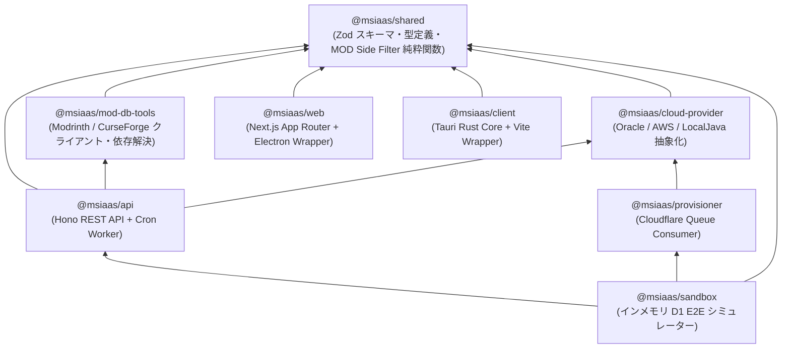
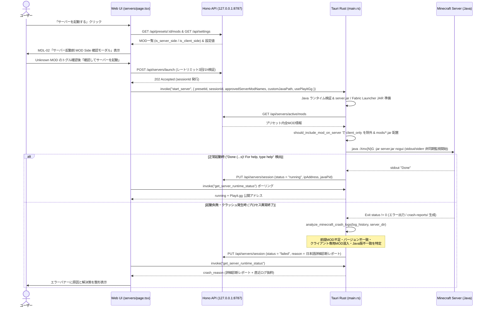
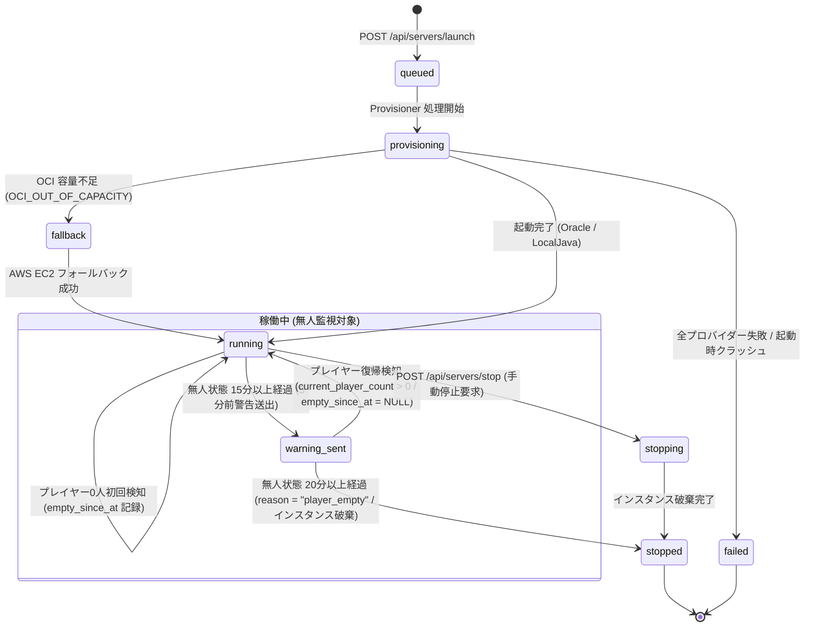

# 内部設計書（Internal Design）

## 1. モノレポ構造とレイヤー依存関係ルール

本プロジェクトは `pnpm` ワークスペース + `Turborepo` によるモノレポ構成を採用し、[`.dependency-cruiser.cjs`](file:///c:/Users/yasud/minecraft-msiaas/.dependency-cruiser.cjs) によって以下の依存制約を機械的に強制しています。

- **`packages/*` から `apps/*` への逆方向依存の完全禁止**（`packages-cannot-depend-on-apps`）
- **循環依存の禁止**（`no-circular`）

---

## 2. クラス・構造体・モジュール関係図（Class Diagram）

TypeScript 共通パッケージ群（`@msiaas/shared`, `@msiaas/mod-db-tools`, `@msiaas/cloud-provider`）、API ルート層（`@msiaas/api`）、および Tauri Rust コア層（`apps/client/src-tauri`）のクラス・構造体関係図です。

```mermaid
classDiagram
    direction TB

    namespace Shared_ModFilter {
        class ScannedMod {
            +string fileName
            +string modId
            +string name
            +string version
            +string loader
            +ModSide detectedSide
            +string side
            +any rawMetadata
            +string explanation
            +string reason
        }
        class ModClassificationResult {
            +ScannedMod[] server
            +ScannedMod[] clientOnly
            +ScannedMod[] client_only
            +ScannedMod[] unknown
            +ScannedMod[] all
        }
        class ModFilterEngine {
            <<Pure Functions>>
            +parseSimpleTOML(content: string) any
            +classifyModSide(fileName: string, metadata: object) ScannedMod
            +scanAndFilterMods(zipData: ArrayBuffer) Promise~ModClassificationResult~
        }
    }

    namespace ModDbTools {
        class UnifiedModProject {
            +string id
            +string slug
            +string title
            +string description
            +string client_side
            +string server_side
            +string download_url
            +string source
            +string loader
        }
        class ModDbClient {
            -string baseUrl
            -string cfBaseUrl
            +searchMods(query, mcVersion, loader, source, cfKey, offset) Promise~SearchResult~
            +resolveDependencies(projectIds, mcVersion, loader) Promise~string[]~
            +resolveCurseForgeDependencies(modIds, mcVersion, loader, apiKey) Promise~string[]~
            +resolveDownloadUrl(source, externalId, mcVersion, loader, cfKey) Promise~string~
            +fetchMods(projectIds, mcVersion, loader) Promise~UnifiedModProject[]~
            +fetchModsFromCurseForge(modIds, apiKey) Promise~UnifiedModProject[]~
        }
    }

    namespace CloudProvider {
        class ICloudProvider {
            <<interface>>
            +CloudProviderType type
            +provision(options: ProvisionOptions) Promise~ServerInstance~
            +getStatus(instanceId: string) Promise~InstanceStatus~
            +terminate(instanceId: string) Promise~void~
        }
        class OracleCloudProvider {
            +type = "oracle"
            +provision(options) Promise~ServerInstance~
            +getStatus(instanceId) Promise~InstanceStatus~
            +terminate(instanceId) Promise~void~
        }
        class AWSProvider {
            +type = "aws"
            +provision(options) Promise~ServerInstance~
            +getStatus(instanceId) Promise~InstanceStatus~
            +terminate(instanceId) Promise~void~
        }
        class LocalJavaProvider {
            +type = "local"
            +provision(options) Promise~ServerInstance~
            +getStatus(instanceId) Promise~InstanceStatus~
            +terminate(instanceId) Promise~void~
        }
        class CloudManager {
            -OracleCloudProvider oracle
            -AWSProvider aws
            -LocalJavaProvider localJava
            +provisionWithFallback(options: ProvisionOptions) Promise~ServerInstance~
            +terminate(instanceId: string) Promise~void~
        }
    }

    namespace TauriRustCore {
        class ServerProcessState {
            +Mutex~Option~Child~~ child
            +Mutex~Option~Child~~ playit_child
            +Mutex~Option~String~~ active_session_id
            +Mutex~Option~String~~ public_address
            +Mutex~Option~String~~ crash_reason
            +Mutex~Vec~String~~ log_history
        }
        class ModInfo {
            +String id
            +String name
            +String source
            +Option~String~ download_url
            +Option~i64~ is_server_side
            +Option~i64~ is_client_side
        }
        class TauriServerEngine {
            <<Rust Commands & Helpers>>
            +start_server(preset_id, session_id, mc_version, loader, memory_gb, approved_server_mod_names, custom_java_path, use_playit_gg)
            +stop_server(session_id)
            +get_server_runtime_status()
            +sync_mods(app_handle)
            +create_guest_mods_zip()
            +download_server_jar(mc_version, loader, dest_path)
            +should_include_mod_on_server(mod_info, approved_names) bool
            +sanitize_jar_filename(name) String
            +analyze_minecraft_crash_logs(lines, server_dir) String
        }
    }

    ModFilterEngine ..> ModClassificationResult : produces
    ModClassificationResult *-- ScannedMod : contains
    ModDbClient ..> UnifiedModProject : returns
    OracleCloudProvider ..|> ICloudProvider
    AWSProvider ..|> ICloudProvider
    LocalJavaProvider ..|> ICloudProvider
    CloudManager *-- OracleCloudProvider
    CloudManager *-- AWSProvider
    CloudManager *-- LocalJavaProvider
    TauriServerEngine --> ServerProcessState : manages
    TauriServerEngine ..> ModInfo : filters & downloads
```

---

## 3. MOD Side Filter アルゴリズム設計

### 3.1 JAR メタデータ検査ロジック ([`mod-filter.ts`](file:///c:/Users/yasud/minecraft-msiaas/packages/shared/src/utils/mod-filter.ts))

[`scanAndFilterMods`](file:///c:/Users/yasud/minecraft-msiaas/packages/shared/src/utils/mod-filter.ts#L294-L384) は `JSZip` を用いてメモリ上で Modpack ZIP を展開し、`mods/` 配下の全 `.jar` ファイルの内部メタデータを走査します。フレームワーク非依存の純粋関数として実装されており、ブラウザ（Next.js）、Electron、Cloudflare Workers、Tauri のいずれからも同一コードで動作します。

| ローダー種別 | 検査対象メタデータファイル | 判定フィールド | 分類ルール (`classifyModSide`) |
| :--- | :--- | :--- | :--- |
| **Fabric** | `fabric.mod.json` | `environment` | `"client"` → **`client_only`** (`detectedSide: 'client'`) `"server"` / `"dedicated_server"` → **`server`** `"*"` または省略時 → **`server`** (`detectedSide: 'both'`) |
| **Quilt** | `quilt.mod.json` | `quilt_loader.environment` または `environment` | `"client"` → **`client_only`** `"server"` / `"dedicated_server"` → **`server`** `"*"` または省略時 → **`server`** (`detectedSide: 'both'`) |
| **Forge / NeoForge** | `META-INF/mods.toml` | `[[dependencies.<modId>]]` 配列内の `modId` & `side` | `modId` が `minecraft` / `forge` / `neoforge` かつ `side == "CLIENT"` → **`client_only`** それ以外（`BOTH` / `SERVER` / 指定なし）→ **`server`** (`detectedSide: 'both'`) |
| **メタデータなし / 破損** | 上記いずれも不在 | - | **`unknown`**（UI 上のデフォルトは「除外 (`client`)」、ユーザー手動トグル対象） |

### 3.2 サーバー起動時の実ファイル配置フィルタリング ([`main.rs`](file:///c:/Users/yasud/minecraft-msiaas/apps/client/src-tauri/src/main.rs))

Tauri Rust バックエンドの [`should_include_mod_on_server`](file:///c:/Users/yasud/minecraft-msiaas/apps/client/src-tauri/src/main.rs#L663-L685) は、サーバーの `mods/` ディレクトリに `.jar` ファイルを配置する際に以下の2段階フィルタを適用します。

1. **ユーザー承認リスト優先判定**:
   - フロントエンドの「サーバー起動前 MOD Side 確認モーダル」から `approved_server_mod_names` が渡された場合、そのリストに含まれる MOD のみを許可し、それ以外をすべてスキップします。
2. **`is_server_side` フラグによる自動防御**:
   - `approved_server_mod_names` が未指定の場合でも、`mod_info.is_server_side == Some(0)`（`client_only`）の MOD は無条件でスキップします。
3. **不要 `.jar` のクリーンアップと拡張子保証**:
   - [`sanitize_jar_filename`](file:///c:/Users/yasud/minecraft-msiaas/apps/client/src-tauri/src/main.rs#L650-L658) により全ファイル名末尾に `.jar` を強制保証し、今回の起動対象リストに含まれない過去の古い `.jar` ファイルは起動前に `mods/` ディレクトリから自動削除します。

---

## 4. サーバー起動＆クラッシュログ自動診断シーケンス

---

## 5. 不在検知・自動停止ステートマシン設計（Cron FSM）

[`apps/api/src/scheduled.ts`](file:///c:/Users/yasud/minecraft-msiaas/apps/api/src/scheduled.ts) は 5 分間隔の Cron（`*/5 * * * *`）で稼働中セッションのプレイヤー数を監視し、以下の状態遷移（FSM）を実行します。すべての遷移は `server_status_logs` テーブルに記録されます。

---

## 6. セキュリティ・レートリミット・設定管理設計

1. **サーバー起動レートリミット（1時間あたり3回制限）**:
   - [`apps/api/src/routes/servers.ts`](file:///c:/Users/yasud/minecraft-msiaas/apps/api/src/routes/servers.ts#L99-L124) にて、`users.last_launch_reset_at` から 1 時間経過していれば `server_launch_count_1h = 1` にリセットし、1 時間以内に 3 回に達している場合は `429 Too Many Requests` を返して過剰なプロビジョニングを防止します。
2. **同時起動サーバーの排他制御**:
   - D1 の部分一意インデックス `uq_session_active_user`（`ON server_sessions (user_id) WHERE stopped_at IS NULL`）および API 事前チェックにより、1 ユーザーあたり同時に起動できるサーバーを厳密に 1 台に制限します。
3. **API キー・シークレットの分離**:
   - `CURSEFORGE_API_KEY` 等の外部シークレットは [`apps/api/wrangler.toml`](file:///c:/Users/yasud/minecraft-msiaas/apps/api/wrangler.toml) に平文記載せず、ローカル開発時は `apps/api/.dev.vars`、本番環境では `wrangler secret put` から注入します。

---

## 7. 更新履歴（Revision History）

| 更新日 | 版 | 更新内容 |
| :--- | :--- | :--- |
| **2026-11-01** | **v1.3.0** | 大量MOD処理時の非同期スレッドアーキテクチャ（`async` + `spawn_blocking`）、並列チャンクスキャン (`scan_jars_in_dir_with_progress`)、JARメタデータキャッシュ (`JAR_META_CACHE`)、ログ集約バッファリング (`server-log-batch`)、UI ChunkedList 設計の追加 |
| **2026-10-30** | **v1.2.0** | Forge Dedicated Server 展開・起動設計、ZIP 前提 MOD 過不足照合アルゴリズム (`available_locally`, `resolve-missing`) の追加 |
| **2026-10-29** | **v1.1.0** | MOD Side Filter アルゴリズム設計・クラッシュログ自動診断シーケンスの初版策定 |
| **2026-10-22** | **v1.0.0** | 初版作成（モノレポ構造・クラス図・FSM設計・セキュリティ設計） |
